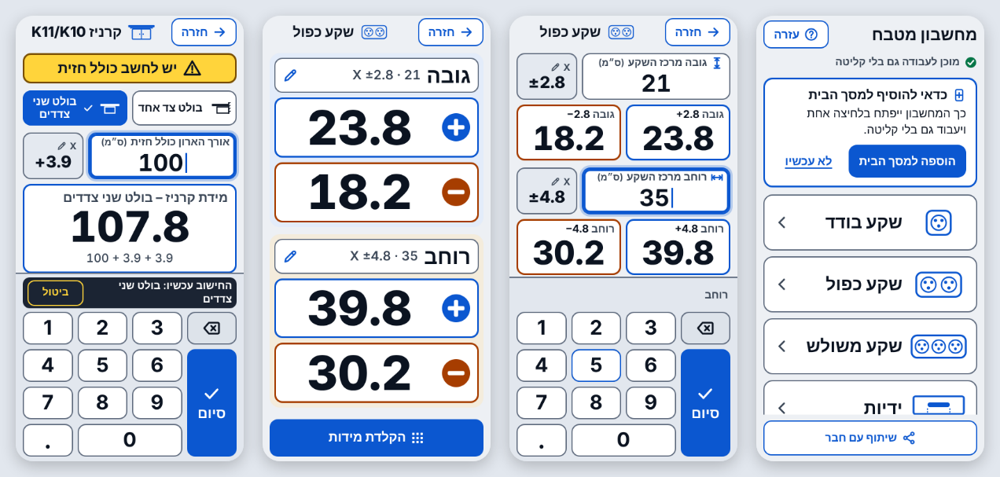

# מחשבון מטבח

מחשבון מידות קטן למתקיני מטבחים: שקעים, ידיות וקרניז.
מספרים גדולים שאפשר לקרוא גם מרחוק, עובד בלי קליטה, ונפתח מסמל במסך הבית כמו אפליקציה.

### ← [לפתיחת המחשבון](https://mamosnoam.github.io/kitchen-calc/)

## מה יש בו

| מחשבון | מה מקלידים | מה מקבלים |
|---|---|---|
| שקע בודד, כפול ומשולש | גובה ורוחב של מרכז השקע | לכל מידה: המידה + X והמידה − X |
| ידיות | מידת הידית ומידת החזית (דלת או מגירה) | המרווח מכל צד: (חזית − ידית) ÷ 2 |
| קרניז K11/K10 | אורך הארון, כולל החזית | בולט צד אחד: אורך + X. בולט שני צדדים: אורך + X + X |

### ערכי X שמגיעים מראש (בס״מ)

| | X לגובה | X לרוחב |
|---|---|---|
| שקע בודד | 2.8 | 3.8 |
| שקע כפול | 2.8 | 4.8 |
| שקע משולש | מגדירים באפליקציה | מגדירים באפליקציה |
| קרניז | 3.9 (לשני הסוגים) | |

לוחצים על X בתוך המחשבון כדי לשנות אותו. השינוי נשמר בטלפון, ותמיד אפשר לחזור לערך המקורי או לבטל.

## איך מקלידים

- לחיצה על שדה רק מסמנת אותו. המספר לא נמחק.
- הספרה הראשונה מחליפה את המספר הקודם, והספרות הבאות מתווספות אליה.
- "הבא" עובר לשדה הבא. "סיום" מסתיר את המקלדת ומגדיל את התוצאות לקריאה מרחוק.

## התקנה בטלפון

- **אייפון (Safari):** פותחים את הקישור ← כפתור השיתוף ← "הוספה למסך הבית" ← "הוסף". אחר כך פותחים פעם אחת מהסמל החדש כשיש קליטה.
- **אנדרואיד (Chrome):** פותחים את הקישור ← ⋮ ← "התקנת אפליקציה" או "הוספה למסך הבית" ← "התקנה".
- **מחשב (Chrome או Edge):** לוחצים על סמל ההתקנה בצד שורת הכתובת.

הוראות מפורטות לכל טלפון יש בתוך המחשבון, בכפתור "הוספה למסך הבית".
אחרי פתיחה אחת עם קליטה המחשבון עובד גם בלי קליטה.

## פרטיות

אין שרת, אין הרשמה ואין איסוף מידע. המספרים וערכי ה-X נשמרים רק בטלפון שלכם.

---

## למי שמתחזק את הקוד

- HTML/CSS/JS רגיל, בלי ספריות ובלי שלב בנייה. האתר מתפרסם ב-GitHub Pages מענף `main`, מתיקיית השורש.
- `core.js`: הנוסחאות בלבד, בלי DOM. החישוב נעשה במספרים שלמים (מאיות), בלי שאריות עשרוניות.
- `config.js`: ערכי X ברירת מחדל, סדר הכפתורים במסך הראשי ומגבלות ההקלדה.
- `app.js`: המסכים, המקלדת וחוק הדריסה.
- `sw.js`: עבודה בלי קליטה ועדכונים.
- **בכל שינוי בקבצי האתר חובה להעלות את `VERSION` ב-`sw.js`.** אחרת טלפונים שכבר פתחו את המחשבון יישארו עם הגרסה הישנה. הגרסה החדשה נטענת בפתיחה הבאה עם קליטה, כשחוזרים למסך הראשי, וערכי ה-X שהמשתמש שינה נשמרים.
- שינוי כתובת האתר (שם המאגר או דומיין) מחייב להוסיף את המחשבון מחדש למסך הבית, ומאפס ערכי X שהמשתמשים שינו.

